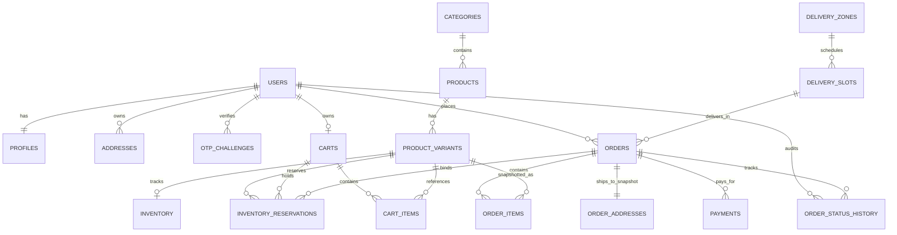
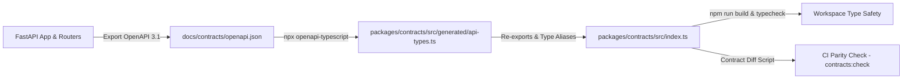

# Phase 2 — Database Entities & API Contracts Implementation Plan (Final Approved)

**Product Name:** DailyKitchen  
**Document:** Phase 2 Detailed Implementation Plan (Final Revision — Post-Review Alignment)  
**Target:** Relational Data Model, SQLAlchemy 2.0 Async Models, Real Alembic Migrations (SQLite & PostgreSQL), Pydantic v2 Schemas, API Error Envelopes, OpenAPI-Generated TypeScript Contracts, Concurrency Safety, Atomicity, & Data Integrity.  
**Date:** October 12, 2026  
**Status:** Approved for Implementation  

---

## 1. Executive Summary & Review Finalizations

This document represents the final, approved technical specification for **Phase 2 (Database Entities & API Contracts)** of DailyKitchen. It addresses all architectural review requirements:

### Key Enforcements & Corrections:
1. **Keyed HMAC-SHA256 OTP Lifecycle:**
   - Hashed using a dedicated `OTP_SECRET` loaded from environment variables (never in code or database).
   - **Locked 5-minute expiry** (300 seconds) and **locked 60-second resend cooldown**.
   - Atomic server-side verification with strict 3-attempt limit.
   - Requesting a new OTP for the same phone and purpose atomically invalidates any existing active challenges.
2. **Dual-Database Migration Verification:**
   - Migration tests run actual `alembic upgrade head` and `alembic downgrade base` against **both SQLite and a real PostgreSQL test database**.
   - Verification covers partial unique indexes (`is_default=True` addresses) and case-insensitive email indexes across both engines.
3. **Atomic Inventory Reservation Accounting:**
   - Reservation creation, hold expiration, release, consumption, and stock counters execute within a single database transaction.
   - State transitions (`active` → `consumed` or `active` → `released` / `expired`) are strictly single-use and idempotent.
   - Automated expiration sweeper releases reserved quantities on abandonment or payment failure.
4. **Backend-Authoritative Pricing & Totals:**
   - Authoritative Formula: `Total = Subtotal + Packaging Fee + Delivery Fee`.
   - Locked Rules: Packaging Fee = ₹10; Delivery Fee = ₹0 if subtotal ≥ ₹99, else ₹40. (Subtotal is produce merchandise subtotal before fees).
   - In-transaction validation: `subtotal` strictly equals `sum(line_total)` of saved `order_items`.
   - **Scope Boundary:** Discounts, promo codes, and partial refunds are **strictly out of scope** for Phase 2.
5. **Payment Audit Integrity & Mock Scope:**
   - Composite uniqueness on `(provider, transaction_id)` prevents duplicate captures.
   - Non-cascading `ondelete="RESTRICT"` preserves all financial audit records.
   - Phase 2 scope uses **mocked payment flows**; live payment gateway SDK integrations occur in a later phase.
6. **Automated OpenAPI TypeScript Parity:**
   - Contract types generated from FastAPI's OpenAPI 3.1 specification via `npx openapi-typescript`.
   - CI parity check (`npm run contracts:check`) fails if generated contracts drift from Pydantic schemas.
   - Workspace build verification in `packages/contracts` passes with 0 TypeScript errors.
7. **Entity Count Reconciled (18 Models):**
   - Exactly 18 SQLAlchemy 2.0 models with explicit relationships, cascading behaviors, and check constraints.
8. **Git Governance:**
   - **Strict Rule:** Zero commits, zero pushes, and zero Git history rewrites during development. Final Git operations occur only after full project completion upon explicit user approval.

---

## 2. Entity Relationship Diagram (ERD)



---

## 3. Comprehensive Entity Specifications (18 Core Models)

All models inherit from `Base` and `TimestampMixin` (`created_at`, `updated_at` in UTC). All primary keys are `String(36)` UUIDs.

### 3.1 Identity & Authentication (4 Models)

#### 1. `users`
- `id`: UUID PK (`String(36)`)
- `phone`: `String(15)`, unique, indexed. Normalized to E.164 (e.g. `+919876543210`).
- `email`: `String(255)`, nullable. Case-insensitive uniqueness enforced via database unique index on `lower(email)`.
- `hashed_password`: `String(255)`, nullable (supports phone-OTP-only authentication).
- `is_phone_verified`: `Boolean`, default `False`.
- `is_email_verified`: `Boolean`, default `False`.
- `is_active`: `Boolean`, default `True`. Soft deletion: Deactivated users cannot log in or perform actions.
- `role`: `String(20)`, default `"customer"`. **Check Constraint:** `role IN ('customer', 'admin', 'delivery_partner')`.
- Retention Policy: Users with order/payment records cannot be hard deleted (`ondelete="RESTRICT"` on `orders.user_id`).

#### 2. `profiles`
- `id`: UUID PK
- `user_id`: UUID FK (`users.id`, `ondelete="CASCADE"`), unique, indexed.
- `full_name`: `String(100)`, nullable.
- `avatar_url`: `String(500)`, nullable.

#### 3. `otp_challenges`
- `id`: UUID PK
- `phone`: `String(15)`, not null, indexed. E.164 format.
- `otp_hash`: `String(255)`, not null. Keyed HMAC-SHA256 (`OTP_SECRET` environment variable). **Never plaintext**.
- `purpose`: `String(30)`, not null. **Check Constraint:** `purpose IN ('login', 'register', 'verify_phone')`.
- `attempts`: `Integer`, not null, default `0`. Max allowed: 3.
- `resend_available_at`: `DateTime(timezone=True)`, not null (exactly 60-second cooldown).
- `expires_at`: `DateTime(timezone=True)`, not null (**strictly 5 minutes from creation**).
- `is_consumed`: `Boolean`, not null, default `False`.
- `ip_address`: `String(45)`, nullable.
- `user_agent`: `String(255)`, nullable.
- Lifecycle rule: When a new OTP is requested for the same `(phone, purpose)`, all existing unconsumed challenges are atomically marked `is_consumed=True` (invalidated).

#### 4. `addresses`
- `id`: UUID PK
- `user_id`: UUID FK (`users.id`, `ondelete="CASCADE"`), not null, indexed.
- `full_name`: `String(100)`, not null.
- `phone`: `String(15)`, not null. E.164 format.
- `house_flat`: `String(100)`, not null.
- `street_area`: `String(255)`, not null.
- `landmark`: `String(150)`, nullable.
- `city`: `String(100)`, not null.
- `state`: `String(100)`, not null.
- `pincode`: `String(6)`, not null, indexed. **Check Constraint:** `length(pincode) = 6`.
- `label`: `String(20)`, default `"home"`. **Check Constraint:** `label IN ('home', 'work', 'other')`.
- `is_default`: `Boolean`, default `False`.
- Unique Default Address Constraint: Partial unique index on `(user_id)` where `is_default = True` (PostgreSQL) and atomic transaction enforcement (SQLite).

---

### 3.2 Product Catalog & Inventory (5 Models)

#### 5. `categories`
- `id`: UUID PK
- `name`: `String(100)`, unique, indexed.
- `slug`: `String(120)`, unique, indexed.
- `description`: `Text`, nullable.
- `image_url`: `String(500)`, not null.
- `display_order`: `Integer`, default `0`.
- `is_active`: `Boolean`, default `True`.

#### 6. `products`
- `id`: UUID PK
- `category_id`: UUID FK (`categories.id`, `ondelete="RESTRICT"`), not null, indexed.
- `name`: `String(150)`, not null, indexed.
- `slug`: `String(180)`, unique, indexed.
- `description`: `Text`, not null.
- `image_url`: `String(500)`, not null.
- `is_fresh_today`: `Boolean`, default `True`.
- `is_popular`: `Boolean`, default `False`.
- `is_active`: `Boolean`, default `True`.

#### 7. `product_variants`
- `id`: UUID PK
- `product_id`: UUID FK (`products.id`, `ondelete="CASCADE"`), not null, indexed.
- `weight_label`: `String(50)`, not null (e.g. `"250g"`, `"500g"`, `"1kg"`, `"1 bunch"`).
- `weight_grams`: `Integer`, not null. **Check Constraint:** `weight_grams > 0`.
- `price`: `Numeric(10, 2)`, not null. **Check Constraint:** `price >= 0`. (Authoritative selling price).
- `mrp`: `Numeric(10, 2)`, not null. **Check Constraint:** `mrp >= price`. (Discount = `mrp - price`).
- `is_available`: `Boolean`, default `True`.
- `display_order`: `Integer`, default `0`.

#### 8. `inventory`
- `id`: UUID PK
- `variant_id`: UUID FK (`product_variants.id`, `ondelete="CASCADE"`), unique, not null.
- `stock_quantity`: `Integer`, not null, default `0`. **Check Constraint:** `stock_quantity >= 0`.
- `reserved_quantity`: `Integer`, not null, default `0`. **Check Constraint:** `reserved_quantity >= 0 AND reserved_quantity <= stock_quantity`.
- `low_stock_threshold`: `Integer`, default `10`. **Check Constraint:** `low_stock_threshold >= 0`.
- Available Stock Formula: `stock_quantity - reserved_quantity`.

#### 9. `inventory_reservations`
- `id`: UUID PK
- `variant_id`: UUID FK (`product_variants.id`, `ondelete="CASCADE"`), not null, indexed.
- `cart_id`: UUID FK (`carts.id`, `ondelete="CASCADE"`), nullable, indexed.
- `order_id`: UUID FK (`orders.id`, `ondelete="SET NULL"`), nullable, indexed.
- `quantity`: `Integer`, not null. **Check Constraint:** `quantity > 0`.
- `status`: `String(20)`, not null, default `"active"`.  
  **Check Constraint:** `status IN ('active', 'consumed', 'released', 'expired')`.
- `expires_at`: `DateTime(timezone=True)`, not null (15-minute checkout hold).
- Single-Use Rule: State transition from `active` to `consumed`, `released`, or `expired` is atomic and irreversible.

---

### 3.3 Shopping Cart (2 Models)

#### 10. `carts`
- `id`: UUID PK
- `user_id`: UUID FK (`users.id`, `ondelete="CASCADE"`), unique, nullable.
- `guest_token_hash`: `String(64)`, unique, nullable, indexed (SHA-256 hash of client guest token).
- `is_active`: `Boolean`, default `True`.
- Guest Cart Lifecycle: Guest sessions supported at the database and schema level. When a guest logs in, items are merged into their authenticated user cart and the guest cart is archived.

#### 11. `cart_items`
- `id`: UUID PK
- `cart_id`: UUID FK (`carts.id`, `ondelete="CASCADE"`), not null, indexed.
- `variant_id`: UUID FK (`product_variants.id`, `ondelete="CASCADE"`), not null, indexed.
- `quantity`: `Integer`, not null, default `1`. **Check Constraint:** `quantity >= 1 AND quantity <= 20`.
- Unique Constraint: `(cart_id, variant_id)`.

---

### 3.4 Delivery & Logistics (2 Models)

#### 12. `delivery_zones`
- `id`: UUID PK
- `name`: `String(100)`, not null.
- `pincode`: `String(6)`, unique, indexed. **Check Constraint:** `length(pincode) = 6`.
- `is_express_available`: `Boolean`, default `True`.
- `is_active`: `Boolean`, default `True`.

#### 13. `delivery_slots`
- `id`: UUID PK
- `zone_id`: UUID FK (`delivery_zones.id`, `ondelete="CASCADE"`), not null, indexed.
- `slot_type`: `String(30)`, not null. **Check Constraint:** `slot_type IN ('instant_express', 'scheduled')`.
- `slot_date`: `Date`, not null.
- `start_time`: `Time`, not null.
- `end_time`: `Time`, not null.
- `timezone`: `String(50)`, default `"Asia/Kolkata"`.
- `max_orders`: `Integer`, default `50`. **Check Constraint:** `max_orders > 0`.
- `current_orders`: `Integer`, default `0`. **Check Constraint:** `current_orders >= 0 AND current_orders <= max_orders`.
- `is_active`: `Boolean`, default `True`.
- Unique Constraint: `(zone_id, slot_date, slot_type, start_time, end_time)`.
- Atomic Booking: Executed with `UPDATE delivery_slots SET current_orders = current_orders + 1 WHERE id = :id AND current_orders < max_orders`.

---

### 3.5 Orders, Payments & Audits (5 Models)

#### 14. `orders`
- `id`: UUID PK
- `order_number`: `String(32)`, unique, indexed (e.g. `DK-20261012-ABC123`).
- `user_id`: UUID FK (`users.id`, `ondelete="RESTRICT"`), not null, indexed.
- `slot_id`: UUID FK (`delivery_slots.id`, `ondelete="RESTRICT"`), not null, indexed.
- `status`: `String(30)`, not null, default `"placed"`.  
  **Check Constraint:** `status IN ('placed', 'confirmed', 'packed', 'out_for_delivery', 'delivered', 'cancelled')`.
- `subtotal`: `Numeric(10, 2)`, not null. **Check Constraint:** `subtotal >= 0`. (Merchandise subtotal before fees).
- `packaging_fee`: `Numeric(10, 2)`, not null, default `10.00`. **Check Constraint:** `packaging_fee >= 0`.
- `delivery_fee`: `Numeric(10, 2)`, not null. **Check Constraint:** `delivery_fee >= 0`.  
  *(Locked Rule: ₹0.00 if subtotal >= ₹99.00 else ₹40.00).*
- `total_amount`: `Numeric(10, 2)`, not null. **Check Constraint:** `total_amount >= 0`.  
  *(Integrity check: `total_amount = subtotal + packaging_fee + delivery_fee`).*
- `payment_method`: `String(30)`, not null. **Check Constraint:** `payment_method IN ('upi', 'card', 'netbanking', 'cod')`.
- `payment_status`: `String(30)`, not null, default `"pending"`.  
  **Check Constraint:** `payment_status IN ('pending', 'authorized', 'captured', 'failed', 'refunded')`.
- `cancellation_reason`: `String(255)`, nullable.
- `notes`: `Text`, nullable.

#### 15. `order_addresses` (Immutable Order Address Snapshot)
- `id`: UUID PK
- `order_id`: UUID FK (`orders.id`, `ondelete="RESTRICT"`), unique, not null, indexed.
- `source_address_id`: `String(36)`, nullable (reference to user address book).
- `full_name`: `String(100)`, not null.
- `phone`: `String(15)`, not null.
- `house_flat`: `String(100)`, not null.
- `street_area`: `String(255)`, not null.
- `landmark`: `String(150)`, nullable.
- `city`: `String(100)`, not null.
- `state`: `String(100)`, not null.
- `pincode`: `String(6)`, not null.
- Snapshot Verification: Backend verifies `source_address_id` belongs to the authenticated user before creating the snapshot. Subsequent edits or deletions of the user address do not affect this record.

#### 16. `order_items` (Immutable Item Snapshot)
- `id`: UUID PK
- `order_id`: UUID FK (`orders.id`, `ondelete="CASCADE"`), not null, indexed.
- `variant_id`: UUID FK (`product_variants.id`, `ondelete="RESTRICT"`), nullable.
- `product_name_snap`: `String(150)`, not null.
- `weight_label_snap`: `String(50)`, not null.
- `unit_price`: `Numeric(10, 2)`, not null. **Check Constraint:** `unit_price >= 0`.
- `mrp_snap`: `Numeric(10, 2)`, not null. **Check Constraint:** `mrp_snap >= unit_price`.
- `quantity`: `Integer`, not null. **Check Constraint:** `quantity >= 1`.
- `line_total`: `Numeric(10, 2)`, not null. **Check Constraint:** `line_total = unit_price * quantity`.
- In-Transaction Validation: `sum(order_items.line_total) == orders.subtotal`.

#### 17. `payments`
- `id`: UUID PK
- `order_id`: UUID FK (`orders.id`, `ondelete="RESTRICT"`), not null, indexed. (Prevents cascading deletion).
- `transaction_id`: `String(100)`, nullable, indexed.
- `idempotency_key`: `String(100)`, unique, not null, indexed.
- `provider`: `String(50)`, not null. **Check Constraint:** `provider IN ('mock', 'razorpay', 'cashfree')`.
- Composite Unique Constraint: `(provider, transaction_id)` when `transaction_id IS NOT NULL`.
- `amount`: `Numeric(10, 2)`, not null. **Check Constraint:** `amount >= 0`.
- `currency`: `String(5)`, default `"INR"`.
- `status`: `String(30)`, not null, default `"pending"`.  
  **Check Constraint:** `status IN ('pending', 'authorized', 'captured', 'failed', 'refunded')`.
- `refund_id`: `String(100)`, nullable, indexed. (Full refund tracking only; partial refunds out of scope).
- `refunded_amount`: `Numeric(10, 2)`, default `0.00`. **Check Constraint:** `refunded_amount >= 0 AND refunded_amount <= amount`.
- `gateway_payload`: `Text`, nullable (Sanitized audit payload with sensitive fields redacted).

#### 18. `order_status_history` (Append-Only Audit Log)
- `id`: UUID PK
- `order_id`: UUID FK (`orders.id`, `ondelete="RESTRICT"`), not null, indexed.
- `from_status`: `String(30)`, nullable.
- `to_status`: `String(30)`, not null.
- `comment`: `String(255)`, nullable.
- `changed_by_user_id`: UUID FK (`users.id`, `ondelete="SET NULL"`), nullable.
- `created_at`: `DateTime(timezone=True)`, not null.
- Immutable log: Append-only operations.

---

## 4. State Machines & Concurrency Architecture

### 4.1 Order Status Transitions
| From Status | Allowed To Statuses | Action / Side-Effect |
| :--- | :--- | :--- |
| `None` (New) | `placed` | Order created, subtotal verified, address snapshotted |
| `placed` | `confirmed` | Payment captured / COD confirmed; inventory consumed |
| `placed` | `cancelled` | Payment failed / cancelled; reservations & slot capacity released |
| `confirmed` | `packed` | Produce picked & packed; order cannot be cancelled by customer |
| `confirmed` | `cancelled` | Admin cancellation; triggers full refund & stock restock |
| `packed` | `out_for_delivery` | Assigned to delivery partner |
| `out_for_delivery` | `delivered` | Final delivery completed |

### 4.2 Payment Status Transitions
| From Status | Allowed To Statuses | Idempotency / Audit Behavior |
| :--- | :--- | :--- |
| `None` (Init) | `pending` | Created with unique `idempotency_key` |
| `pending` | `authorized` | Provider pre-auth success |
| `pending` | `captured` | Immediate payment capture (Mock / UPI) |
| `pending` | `failed` | Payment declined; triggers reservation release |
| `authorized` | `captured` | Settlement confirmed |
| `authorized` | `failed` | Auth voided / expired |
| `captured` | `refunded` | Full refund recorded with `refund_id` |

### 4.3 Atomic Inventory & Capacity Release Workflow
- **On Checkout Abandonment / Payment Failure / Order Cancellation:**
  1. Set `inventory_reservations.status = 'released'` where `status = 'active'`.
  2. Decrement `inventory.reserved_quantity` by reservation quantity within the same transaction.
  3. Decrement `delivery_slots.current_orders` by 1 where `current_orders > 0`.
- **Scheduled Expiry Worker:**
  - Periodic background query:
    ```sql
    SELECT * FROM inventory_reservations
    WHERE status = 'active' AND expires_at < CURRENT_TIMESTAMP;
    ```
  - For each expired reservation, atomically mark status `'expired'` and decrement `inventory.reserved_quantity`.

---

## 5. Automated TypeScript Contract Parity Strategy



1. **Reproducible Generation Script:**
   - Command: `npm run generate:contracts` (invokes `python -m backend.app.scripts.export_openapi` followed by `openapi-typescript`).
2. **CI Parity Validation:**
   - Command: `npm run contracts:check` fails CI if generated files have uncommitted drift from backend models.
3. **Zod Validation Alignment:**
   - Frontend form schemas in `packages/validation` tested against generated TypeScript contracts using `z.infer<T>`.

---

## 6. Recommended Implementation Sequence

```text
Step 2.1: Finalize Entity Specifications, Constraints & ERD
└── Lock all 18 models, check constraints, composite indexes, and cascade behaviors.

Step 2.2: Implement SQLAlchemy 2.0 Async ORM Models in backend/app/models/
├── base.py (Base, TimestampMixin, UUIDGenerator)
├── user.py (User, Profile, Address, OtpChallenge)
├── catalog.py (Category, Product, ProductVariant, Inventory, InventoryReservation)
├── cart.py (Cart, CartItem)
├── delivery.py (DeliveryZone, DeliverySlot)
└── order.py (Order, OrderAddress, OrderItem, Payment, OrderStatusHistory)

Step 2.3: Configure Alembic & Execute Dual-Database Migration Tests
├── Generate migration: alembic revision --autogenerate -m "create_initial_phase2_schema"
├── Test upgrade head & downgrade base against SQLite
└── Test upgrade head & downgrade base against real PostgreSQL test instance

Step 2.4: Implement Pydantic v2 Request/Response Schemas & Envelopes
├── common.py (ApiResponse[T], ApiError, PaginationParams)
├── auth.py (OtpSendRequest, OtpVerifyRequest, AuthTokenResponse)
├── user.py (UserRead, ProfileUpdate, AddressCreate, AddressRead)
├── catalog.py (CategoryRead, ProductRead, ProductVariantRead, InventoryRead)
├── cart.py (CartItemCreate, CartItemUpdate, CartRead)
├── delivery.py (DeliveryZoneRead, DeliverySlotRead)
└── order.py (OrderCreate, OrderRead, PaymentIntentCreate, PaymentRead)

Step 2.5: Generate TypeScript Contracts & Add Parity Verification
├── Add export_openapi script in backend/app/scripts/
├── Configure packages/contracts with openapi-typescript generation and contracts:check script
└── Execute npm run build and npm run typecheck in packages/contracts

Step 2.6: Seed Data & Pricing / Concurrency Verification
├── Seed authentic produce categories & variants (zero fake reviews, ratings, or claims)
└── Verify subtotal >= ₹99 free delivery logic, ₹10 packaging fee, and atomic slot booking

Step 2.7: Comprehensive Automated Test Suite in backend/tests/
├── test_models.py (Relationships, check constraints, cascades, indexes)
├── test_schemas.py (Pydantic serialization, Decimal precision, error formatting)
├── test_concurrency.py (Atomic slot booking, inventory hold & expiration sweep)
├── test_migrations.py (Real SQLite and PostgreSQL upgrade/downgrade roundtrips)
└── test_pricing.py (Boundary conditions, ₹99 threshold, subtotal item parity)

Step 2.8: Audit Documentation & Verification Evidence
└── Record test outputs, database logs, and verification proof in docs/audits/phase-2-verification.md
```

---

## 7. Acceptance Criteria & Definition of Done

1. **ORM Integrity:** Exactly **18 SQLAlchemy models** defined with typed mappings (`Mapped[...]`), foreign keys, check constraints, and performance indexes.
2. **OTP Security:** Keyed HMAC-SHA256 hashing via `OTP_SECRET`; strictly 5-minute expiry, 60s cooldown, max 3 attempts; unconsumed challenges invalidated upon resend; plaintext OTPs never stored.
3. **Dual Migration Verification:** Real `upgrade head` and `downgrade base` executed and verified against both SQLite and PostgreSQL.
4. **Historical Snapshots:** Orders contain dedicated, immutable snapshots for items (`order_items`) and delivery addresses (`order_addresses`).
5. **Database Check Constraints:** Rejects negative prices, negative stock, invalid reservations, out-of-range quantities, and capacity violations at the DB engine level.
6. **Concurrency & Atomicity:** Inventory reservation and slot bookings handle concurrent checkout attempts atomically without overbooking.
7. **Audit & Retention:** Payments use `ondelete="RESTRICT"`; orders cannot be deleted if payment history exists; composite uniqueness on `(provider, transaction_id)`.
8. **Contract Parity:** `packages/contracts` builds cleanly with generated types matching FastAPI OpenAPI schemas; parity check script passes.
9. **Authoritative Pricing:** Server calculates pricing with ₹99 free delivery threshold and ₹10 packaging fee; validates `subtotal == sum(line_total)` in transaction.
10. **Ethical Catalog Seeding:** Seed data contains genuine produce variants without fabricated customer reviews, ratings, or claims.
11. **Git Policy Adherence:** Zero commits, zero pushes, zero Git history modifications during development.
12. **Audit Evidence:** All actual test results and evidence recorded in `docs/audits/phase-2-verification.md`.
