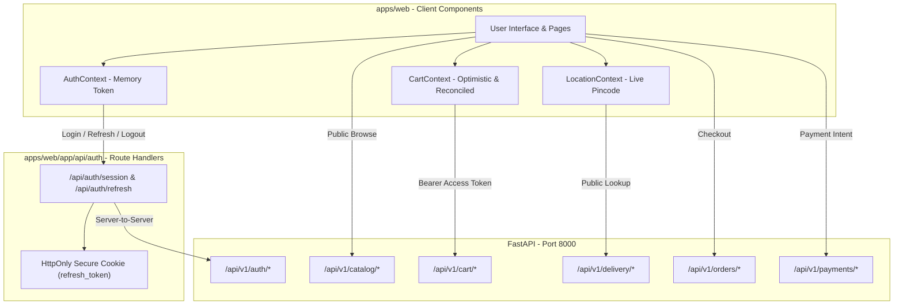

# Phase 5 — Customer Web Experience & Unified API Client Implementation Plan (Hardened)

**Product Name:** DailyKitchen  
**Document:** Phase 5 Detailed Implementation Plan (Hardened with Pre-Implementation Corrections)  
**Depends On:** Phase 1–4 Verification & Stabilization Complete (`docs/audits/phase-1-to-4-comprehensive-verification.md`)  
**Date:** October 13, 2026  
**Status:** Approved for Implementation  

---

## 1. Executive Summary & Mandatory Safeguards

This revised implementation plan incorporates all required security, session, endpoint, and recovery safeguards prior to executing Phase 5. The primary objective is to build a responsive, production-grade customer web application in `apps/web` (Next.js 14 App Router) that interacts with the verified FastAPI backend with zero architectural drift.

### 🛡️ Five Non-Negotiable Pre-Implementation Invariants

1. **Secure Session & Token Storage:**
   - Persistent refresh tokens are **NEVER** stored in `localStorage` or accessible to client JavaScript where XSS could exfiltrate them.
   - Implemented via a Next.js Route Handler BFF (`apps/web/app/api/auth/[...action]/route.ts`) that manages an `HttpOnly`, `Secure`, `SameSite=Strict` cookie containing the persistent `refresh_token`.
   - The short-lived `access_token` (15 min) is held strictly in React memory (`AuthContext`).
   - Concurrent refresh requests are deduplicated using a single in-flight mutex/promise to prevent replay detection from triggering accidental token family revocation.
2. **Server-Authoritative Payments (Zero Browser Webhook Simulation):**
   - The browser never confirms payment, fabricates a webhook event, or calls `/api/v1/payments/webhook`.
   - Webhook processing remains strictly server-to-server with HMAC-SHA256 signature verification.
   - In development/test mode, payments can be completed via Cash on Delivery (`cod`) or an explicitly authenticated, server-side test payment verification route guarded by `ENVIRONMENT in ('development', 'test')`.
3. **100% Verified Endpoint Alignment:**
   - Every API call is verified against `backend/app/api/v1/api.py` and the OpenAPI schema:
     - Auth: `POST /api/v1/auth/otp/send`, `POST /api/v1/auth/otp/verify`, `POST /api/v1/auth/refresh` (NOT `/token/refresh`), `POST /api/v1/auth/logout`, `GET /api/v1/auth/me`.
     - Users: `GET /api/v1/users/me`, `PATCH /api/v1/users/me/profile`, `GET|POST /api/v1/users/me/addresses`, `PUT /api/v1/users/me/addresses/{id}/default`.
     - Catalog: `GET /api/v1/catalog/categories`, `GET /api/v1/catalog/products`, `GET /api/v1/catalog/products/{slug}`.
     - Cart: `GET /api/v1/cart`, `POST /api/v1/cart/items`, `PATCH /api/v1/cart/items/{id}`, `DELETE /api/v1/cart/items/{id}`, `DELETE /api/v1/cart/clear`.
     - Delivery: `GET /api/v1/delivery/zones/check?pincode={pincode}`, `GET /api/v1/delivery/zones`, `GET /api/v1/delivery/slots?zone_id={zone_id}`.
     - Orders: `POST /api/v1/orders`, `GET /api/v1/orders`, `GET /api/v1/orders/{id}`, `POST /api/v1/orders/{id}/cancel`.
     - Payments: `POST /api/v1/payments/intent`.
4. **Recoverable Optimistic Cart Mutations:**
   - Cart actions update UI optimistically for sub-50ms responsiveness.
   - If an update fails (e.g. 422 stock exhausted, 401 unauthenticated, network drop), the state machine reverts to the previous snapshot, re-fetches the authoritative cart from `GET /api/v1/cart`, and displays a non-blocking toast with the server detail.
   - In-flight request debouncing prevents race conditions and out-of-order responses.
5. **Dynamic Real Data (No Hardcoded Delivery Assumptions):**
   - No hardcoded catalog items, slots, or prices in client code.
   - PIN `560034` is treated strictly as an initial development fixture; customer location is queried live via `/api/v1/delivery/zones/check`.
   - Real backend rules are surfaced: ₹10 packaging fee, ₹40 delivery fee below ₹99, and free delivery at ₹99+.

> **Git Governance:** No commits, no pushes, no history rewrites, and no destructive git operations at any time. Do not begin Phase 6 or 7.

---

## 2. System Architecture & Component Diagram

---

## 3. Step-by-Step Implementation Sequence

### Step 5.1: Audit & Unified API Client
- **Deliverables:**
  - `apps/web/src/lib/api-client.ts`:
    - Base URL derived from `NEXT_PUBLIC_API_URL || 'http://127.0.0.1:8000/api/v1'`.
    - Automated `Authorization: Bearer <token>` injection for authenticated requests.
    - Token refresh interceptor: detects 401, calls Next.js BFF `/api/auth/refresh`, updates in-memory token, and replays failed requests.
    - Request deduplication for refresh: a single shared Promise ensures multiple 401s do not trigger concurrent refresh calls.
  - Next.js Route Handlers:
    - `apps/web/app/api/auth/session/route.ts`: Sets/reads the `HttpOnly`, `SameSite=Strict` refresh cookie and exchanges with backend.
    - `apps/web/app/api/auth/logout/route.ts`: Clears cookie and notifies backend session revocation.

### Step 5.2: Contexts & Application Shell
- **Deliverables:**
  - `apps/web/src/context/AuthContext.tsx`:
    - Stores `user`, `accessToken` in memory.
    - Methods: `requestOtp(phone)`, `verifyOtp(phone, otp)`, `logout()`, `refreshSession()`.
  - `apps/web/src/context/LocationContext.tsx`:
    - Stores `pincode`, `zone` (`DeliveryZoneRead`), `isServiceable`, `isChecking`.
    - Queries `/api/v1/delivery/zones/check?pincode=...`.
  - `apps/web/src/context/CartContext.tsx`:
    - Stores `cart` (`CartReadWithPricing`), `itemCount`, `isOpen`, `isUpdating`, `error`.
    - Supports recoverable optimistic additions/updates/deletions.
  - `apps/web/src/components/layout/Header.tsx` & `Footer.tsx`:
    - Sticky navigation bar with location pill, debounced search, account trigger, and cart trigger with live count badge.
    - Accessible footer with Consumer Protection & FSSAI notices.

### Step 5.3: Location & Authentication UI
- **Deliverables:**
  - `apps/web/src/components/modals/LocationModal.tsx`:
    - Accessible dialog with autofocus, 6-digit regex validation, and clear serviceability messaging.
  - `apps/web/src/components/modals/AuthModal.tsx`:
    - Step 1: Phone input with `+91` prefix and validation.
    - Step 2: 4-digit discrete auto-advancing OTP input with 60-second cooldown timer.
    - Development mode helper: "Fetch Test OTP" button calling `/api/v1/auth/test/last-otp` (strictly gated to dev environment).
  - `apps/web/src/components/profile/AddressDrawer.tsx`:
    - Address list from `GET /api/v1/users/me/addresses`.
    - Form to add new address (`POST /api/v1/users/me/addresses`).
    - Option to set default address (`PUT /api/v1/users/me/addresses/{id}/default`).

### Step 5.4: Catalog & Product Discovery
- **Deliverables:**
  - `apps/web/src/components/catalog/CategoryTabs.tsx`:
    - Fetches active categories from `GET /api/v1/catalog/categories`.
    - Keyboard-navigable tab list.
  - `apps/web/src/components/catalog/SearchBar.tsx`:
    - 300ms debounced input querying `GET /api/v1/catalog/products?q=...`.
    - Empty state with suggestion pills.
  - `apps/web/src/components/catalog/ProductCard.tsx`:
    - High-quality image container with loading fallback.
    - Weight variant pills (e.g. `500g` vs `1kg`).
    - Real-time stock status badge (In Stock vs Out of Stock).
    - Authoritative pricing: Offer price vs MRP strikethrough.
    - Interactive "Add" button that toggles into a quantity increment/decrement stepper.

### Step 5.5: Cart & Authoritative Pricing Drawer
- **Deliverables:**
  - `apps/web/src/components/cart/CartDrawer.tsx`:
    - Slide-over panel with accessibility traps and ESC dismissal.
    - Real-time line items with thumbnail, weight label, unit price, quantity stepper, and remove action.
    - **Free Delivery Progress Tracker:** Shows exact remaining amount needed to reach ₹99 threshold.
    - **Authoritative Bill Breakdown:**
      - Merchandise Subtotal
      - Packaging Fee (₹10.00)
      - Delivery Fee (₹40.00 or FREE)
      - Total Amount
    - Checkout CTA button leading to `/checkout`.

### Step 5.6: Checkout & Payments Pipeline
- **Deliverables:**
  - `apps/web/app/checkout/page.tsx`:
    - Step 1: Delivery Address selection or inline addition.
    - Step 2: Delivery Slot Picker: queries `GET /api/v1/delivery/slots?zone_id=...` and presents Morning, Evening, and Express slots with remaining capacity.
    - Step 3: Payment Method: Cash on Delivery (`cod`) or Online UPI (`upi`).
    - Step 4: Review server-calculated totals.
    - Order Submission: calls `POST /api/v1/orders`. On success, redirects to `/orders/[id]`.
    - Failure Recovery: handles full slots (409), out-of-stock items (422), or expired sessions with clear actionable notifications without dropping the customer's cart.

### Step 5.7: Order Tracking & History
- **Deliverables:**
  - `apps/web/app/orders/[id]/page.tsx`:
    - Queries `GET /api/v1/orders/[id]`.
    - Status progress stepper (`placed` → `confirmed` → `out_for_delivery` → `delivered`).
    - Order summary with immutable snapshots of items, addresses, and fees.
    - Cancel order action (`POST /api/v1/orders/[id]/cancel`) when order is in `placed` status.

### Step 5.8: Verification, Testing & Audit
- **Deliverables:**
  - TypeScript typecheck across all 6 workspaces: `npm run typecheck` (0 errors).
  - Next.js production build: `npm run build --workspace=@dailykitchen/web` (Exit code 0).
  - Full backend regression suite: `PYTHONPATH=. pytest backend/tests -v` (85/85 passed).
  - Interactive browser validation of end-to-end customer journey using browser subagent.
  - Final audit document: `docs/audits/phase-5-verification.md`.

---

## 4. Acceptance Criteria Checklist

- [ ] Next.js BFF proxy secures refresh token in `HttpOnly`, `SameSite=Strict` cookie (no refresh tokens in `localStorage`).
- [ ] Concurrent refresh requests deduplicated with zero replay errors.
- [ ] Every API endpoint matches the real OpenAPI schema.
- [ ] Optimistic cart mutations recover gracefully on 422 stock error or network failure.
- [ ] Real database categories, products, variants, and delivery zones load dynamically.
- [ ] ₹10 packaging fee and ₹99 free delivery threshold correctly reflected and verified against server calculations.
- [ ] Slot booking and order placement execute cleanly via `/api/v1/orders`.
- [ ] Production build (`next build`) completes with Exit Code 0.
